# River City Quest

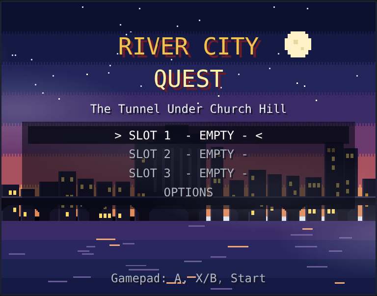

A Zelda-style adventure set in Richmond, Virginia, with SNES-style pixel art. It runs in any browser and on phones, with no install needed.

A top-down adventure game set in Richmond, Virginia. A cold fog has rolled up off the James. Find four keystones hidden in the Belle Isle quarry, the Hollywood Cemetery pyramid, the Poe Museum cellar and the Carillon, unseal the Church Hill Tunnel, and face what's been down there since 1925.

**Play it:** https://doodersrage.github.io/river-city-quest/

| | | |
|---|---|---|
| 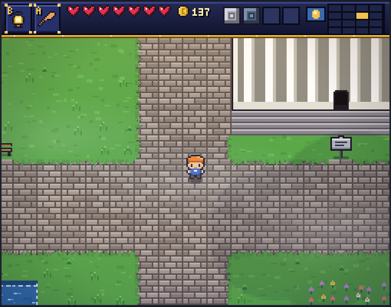 |  |  |
| Capitol Square by day | Broad Street at night | Rain in Jackson Ward |
| 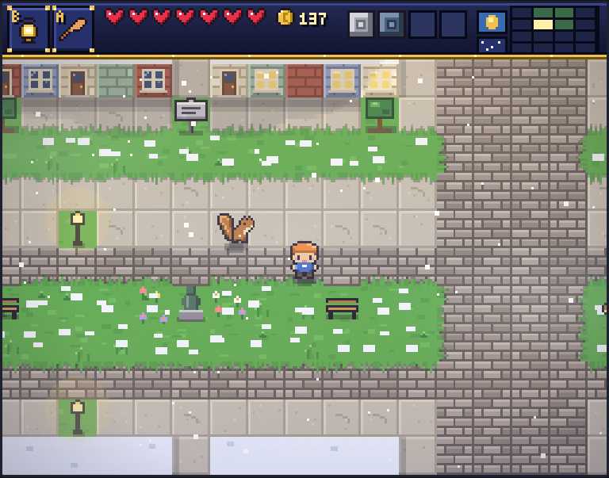 | 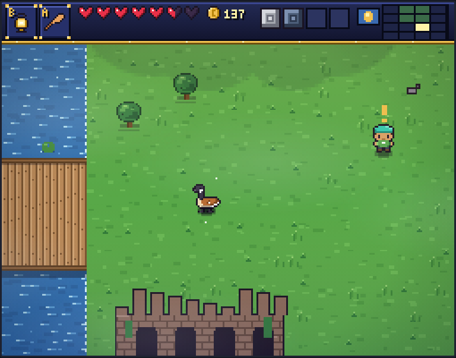 | 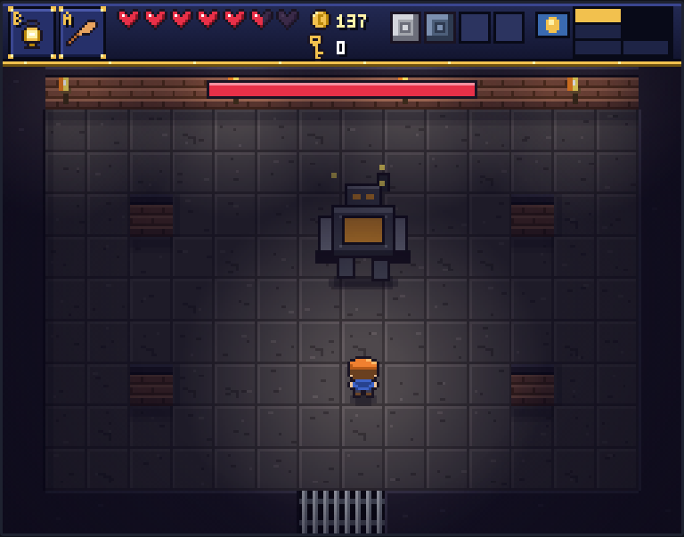 |
| Snow in the Fan | Belle Isle | The Iron Foreman at Tredegar |
|  | 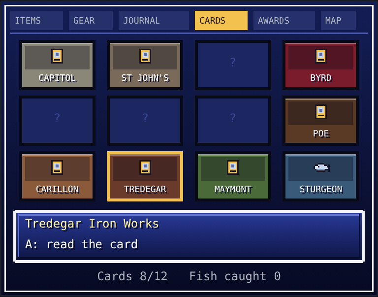 | 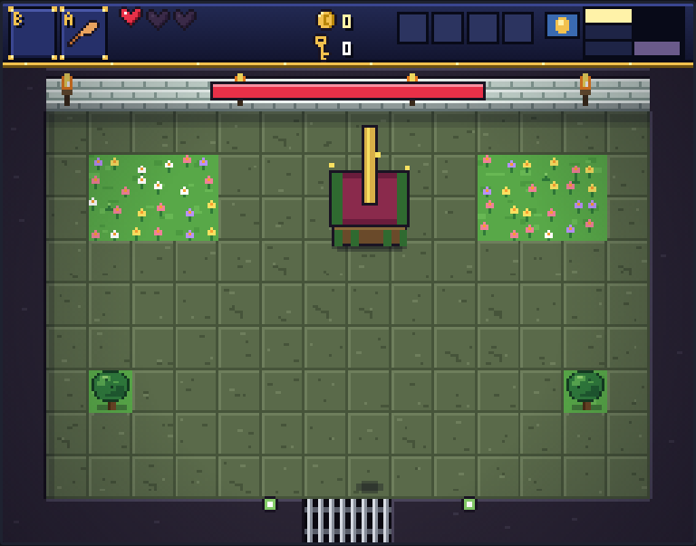 |
| Fishing at Pony Pasture | Landmark cards | The Titan Arum in the conservatory |
| 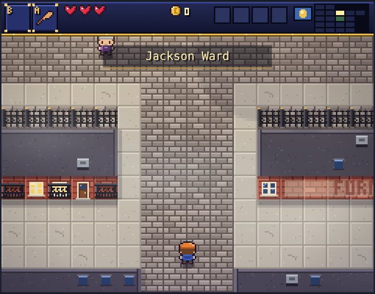 | 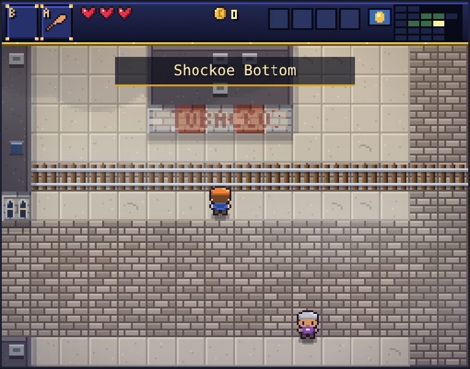 |  |
| Cast-iron porches in Jackson Ward | A ghost sign in Shockoe Bottom | Broad Street at night |
| 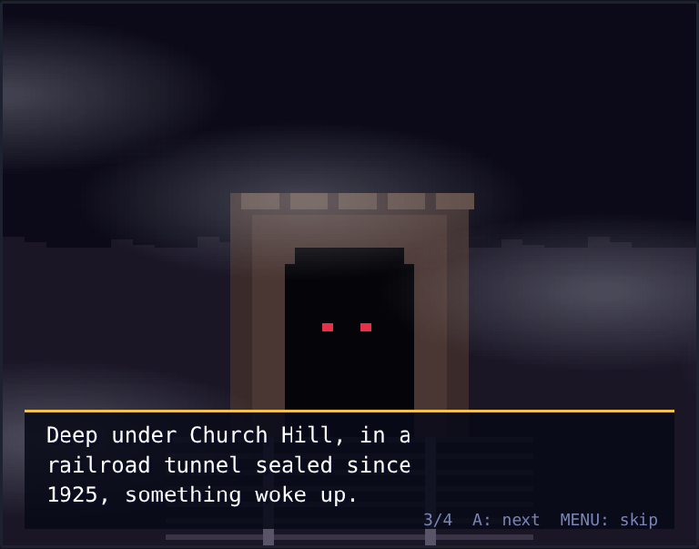 | 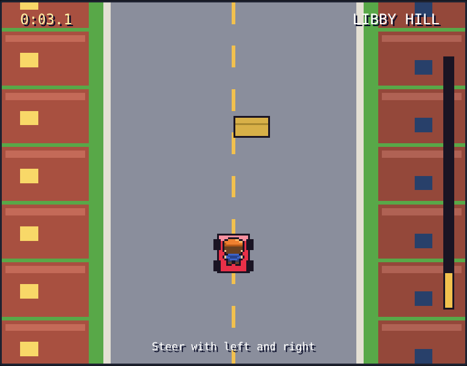 | 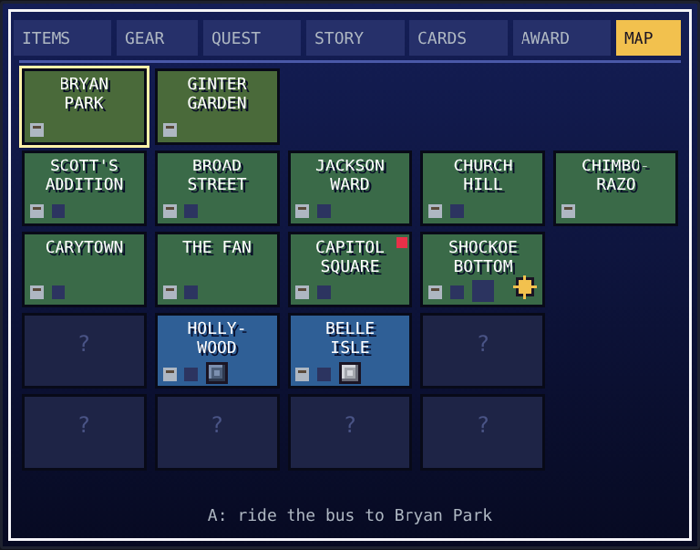 |
| The opening | The Libby Hill soapbox derby | The city map, with bus travel |
| 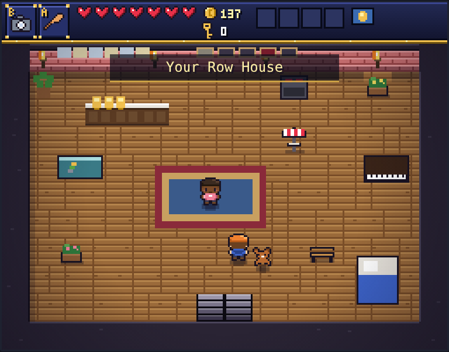 | | |
| Your row house in the Fan, with your dog | | |

On a phone, use your browser's "Add to Home Screen" (or the INSTALL button when it appears) to run it full screen like an app. It works offline after the first visit.

## Controls

| | Phone | Keyboard | Gamepad |
|---|---|---|---|
| Move | Thumb pad | Arrows or WASD | D-pad or left stick |
| A: swing, talk, read, open, push | A button | Z, J or Space | A |
| Spin attack | Hold A after a swing, then let go | Same | Same |
| B: use the equipped item | B button | X or K | X or B |
| Inventory, journal, cards, map | MENU (top right) | Enter, Esc, I or M | Start |
| Sound on or off | SOUND (top right) | N | |

Progress saves automatically in your browser, in one of three save slots. OPTIONS on the title screen lets you turn on a speedrun timer and remap the keyboard (arrow keys and Enter always work).

## What's in it

- **19 scrolling neighborhoods**, each a big map you explore in any direction: Bryan Park and Lewis Ginter Botanical Garden up north, Scott's Addition, Broad Street, Jackson Ward, Church Hill, Chimborazo, Carytown and the VMFA, the Fan, Capitol Square, Shockoe Bottom, Byrd Park and Maymont, Hollywood Cemetery, Belle Isle, Rocketts Landing, and south of the river, Pony Pasture, Forest Hill Park, Manchester and Ancarrow's Landing.
- **A Richmond look:** cast-iron porches in Jackson Ward, clapboard houses and tin roofs on Church Hill, bay windows in the Fan, arched-window warehouses in Shockoe, Scott's Addition and Manchester, faded ghost signs and murals on old brick, a tea-green James with granite boulders in the rapids, magnolias and dogwoods, iron scrollwork on the menus, and the real skyline on the title screen.
- **Landmarks drawn as themselves:** The Diamond's grandstand, the Broad Street department stores, the Hippodrome, St. John's Church, the Capitol and its bell tower, Main Street Station, the 17th Street Market, the Carillon, Maymont House, the granite pyramid, Monroe's tomb, the Belle Isle ruins, a steamboat at Rocketts, Forest Hill's Stone House and an old trolley.
- **Street life:** townspeople who walk around and chat, buses and cars that stop for you, pigeons that scatter, gas lamps, benches, cafe tables and murals.
- **A challenge in every neighborhood,** from shagging fly balls at The Diamond and lighting Church Hill's gas lamps to a Monument Avenue race, a Richmond history quiz and a mural hunt in Manchester. Each first win earns a city pin. Collect all 14 for a golden paddle.
- **Places to walk into:** a taproom, the Miller & Rhoads Tea Room, the Hippodrome, St. John's, the Carytown shop, a Fan row house, Main Street Station, Maymont House, a Rocketts boathouse, the Stone House arcade and a Manchester art studio, plus a hidden chest in every neighborhood.
- **Seven dungeons and a finale** with small keys, locked doors, cracked walls, braziers, push-block puzzles and a boss each. Tredegar Iron Works, behind Hollywood Cemetery, hides the Grappling Hook and the Iron Foreman. The conservatory at Lewis Ginter hides the Watering Can and the Titan Arum. The Church Hill Tunnel ends in a three-phase fight, then the lamps come back on across the city.
- **Day and night:** a full day passes about every ten minutes. Gas lamps and windows light up after dark, fireflies come out in the parks, and bats and ghosts roam the streets.
- **Weather:** rain with puddles, snow that piles up on rooftops, and fog off the James. Frogs come out in the rain for the naturalist's frog count at Byrd Park.
- **Fishing:** buy a rod in Carytown and fish any pond or the river. Bluegill, bass, catfish at night, shad in the rain and, if you're lucky, an Atlantic sturgeon.
- **12 landmark cards** to collect from bosses, card packs, the frog count and the river.
- **Items for the B button:** Gas Lantern, Baseballs, Blasting Powder, the Gold-Bug, Running Shoes, Grappling Hook, Fishing Rod, Watering Can and Ginger Beer. The Cast-Iron Shield and the Kayak work on their own.
- **A trading quest** across town that ends with a kayak for crossing the whitewater on the James, and a **bateau quest** on the south bank that ends with a Golden Lure.
- **Eight heart pieces** hidden behind bushes, across water and in the rapids. Four make a heart.
- **A journal of 47 Richmond stories** from historical markers, statues and people around town: Patrick Henry at St. John's, Maggie L. Walker's bank, Bojangles' traffic light, Sprague's electric streetcars, the VMFA's Faberge eggs, the Carillon, Forest Hill's old amusement park, Mayo's Bridge, the Church Hill Tunnel collapse and more.
- **Chiptune music** for the city, the south bank, nighttime, dungeons, the Tredegar foundry, bosses and the title screen, plus rain, wind and cricket sounds.
- **Everyday Richmond:** adopt a dog from the shelter in Manchester who follows you, sniffs out stashes, chases pests and digs up treats. Take photos of 19 landmarks for your album. Decorate your row house in the Fan with trophies, cards and furniture, cook at its stove and sleep until morning or evening. Ride a bike from Rocketts and race the Capital Trail time trial. Every in-game Friday night is First Friday on Broad Street, with a gallery hunt.
- **Español:** menus, items, quests, awards, cards, hints, the opening and the shop can be switched to Spanish in OPTIONS. Dialog and journal stories are still in English.
- **Getting around:** ride the GRTC bus from the map to any neighborhood you've visited. A star on the map marks your next goal, and the QUEST tab tracks every quest.
- **Mini-games:** batting practice at The Diamond, pinball in the Stone House arcade, and a soapbox derby down Libby Hill.
- **A hidden stash in every neighborhood.** Look for a glint near trees, rocks and bushes.
- **Seasons by the real calendar:** falling leaves in autumn, holiday lights in the Fan and Carytown in December, azaleas at Bryan Park in spring, runners in the Fan during 10K season, and music from the Folk Festival in October.
- **Sound:** footsteps that change with the ground, voices for each enemy, and fanfares for big items.
- **Hints when you need them:** the GEAR tab always shows your next goal, and townspeople react to the weather, the time of day and how far you've come.
- **An opening and credits:** name your hero, watch the fog roll in, and roll the credits at the end.
- **Sharing:** copy a save code from one device and import it on another, and share a picture of your finish time.
- **Phones:** vibration, a sideways layout with the controls beside the screen, a FULL button for full screen, and the game pauses when you switch apps.
- **Replay:** New Game+ (tougher foes that hit harder), a boss rush against all six bosses, 15 awards, and split times for each dungeon on the ending screen.
- **Accessibility options:** bigger dialog text, color assist labels, a calm mode with no screen shake or damage flash, and small, medium or large touch buttons.

## Files

No build step and no dependencies. Open `index.html` in a browser to play locally. The scripts load in order from `index.html`:

- `js/world.js`: the maps, rooms, dungeon links and journal text
- `js/core.js`: setup, sprites, game state, saving, sound effects and dialog
- `js/people.js`: challenges, items, the shop and what everyone in town says
- `js/play.js`: movement, enemies, bosses, the update loop and menu controls
- `js/art.js`: tile art and the hand-drawn landmarks
- `js/style.js`: Richmond's look: ironwork, ghost signs, murals, house styles, river colors, trees and the skyline
- `js/draw.js`: the world, HUD, menus, title and ending screens
- `js/es.js`: Spanish text
- `js/life.js`: the dog, camera and album, your row house, cooking, the bike and First Friday
- `js/minigames.js`: batting practice, pinball and the soapbox derby
- `js/extras.js`: the relighting finale, bus travel, the quest log, secrets, seasons and extra sounds
- `js/systems.js`: cards, time of day, weather, fishing, the hook, options, story beats, awards, New Game+, boss rush, the opening and sharing
- `js/main.js`: page buttons, input and the main loop
- `js/music.js`: the music sequencer, songs and weather sounds
- `sw.js`, `manifest.webmanifest`, `icon-*.png`: install-to-home-screen and offline support

## Tests

Run `node tests/run.js` (Node 18 or newer, nothing to install). It loads the game into Node with a stand-in canvas and runs:

- `maps.test.js`: every door, chest, person and item can be reached, counting the grappling hook, and map edges line up
- `sim.test.js`: a random-input run through every scene, plus scripted checks of each challenge
- `features.test.js` and `more-features.test.js`: the newer systems, from weather and fishing to New Game+ and the boss rush
- `final-act.test.js`: the finale's boss phases and relighting, bus travel, the quest log, secrets, all three mini-games and the seasons
- `life.test.js`: the dog, photos, home, cooking, the bike and trail, First Friday and Spanish
- `names.test.js`: no two scripts declare the same top-level name, since they share one scope
- `playthrough.test.js`: a bot plays from a new game to the ending, walking through every dungeon door for real and checking the hint at each step

GitHub Actions runs them on every push.

Maps are written as run-length rows, so `B14 p4 B14` is 14 building tiles, 4 cobblestone tiles and 14 more buildings. When you change any file, bump `VERSION` in `sw.js` so installed copies update.
