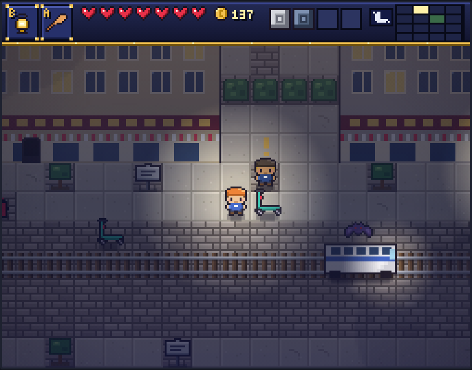
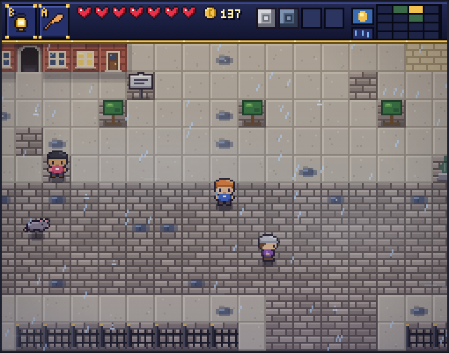
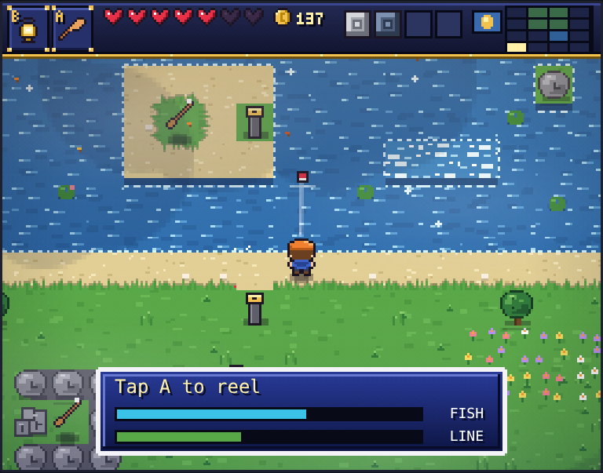

# River City Quest

A Zelda-style adventure set in Richmond, Virginia, with SNES-style pixel art. It runs in any browser and on phones, with no install needed.

A top-down adventure game set in Richmond, Virginia. A cold fog has rolled up off the James. Find four keystones hidden in the Belle Isle quarry, the Hollywood Cemetery pyramid, the Poe Museum cellar and the Carillon, unseal the Church Hill Tunnel, and face what's been down there since 1925.

**Play it:** https://doodersrage.github.io/river-city-quest/

| | | |
|---|---|---|
|  |  |  |
| Capitol Square by day | Broad Street at night | Rain in Jackson Ward |
|  |  |  |
| Snow in the Fan | Belle Isle | The Iron Foreman at Tredegar |
|  |  | |
| Fishing at Pony Pasture | Landmark cards | |

On a phone, use your browser's "Add to Home Screen" (or the INSTALL button when it appears) to run it full screen like an app. It works offline after the first visit.

## Controls

| | Phone | Keyboard | Gamepad |
|---|---|---|---|
| Move | Thumb pad | Arrows or WASD | D-pad or left stick |
| A: swing, talk, read, open, push | A button | Z, J or Space | A |
| Spin attack | Hold A after a swing, then let go | Same | Same |
| B: use the equipped item | B button | X or K | X or B |
| Inventory, journal, cards, map | MENU (top right) | Enter, Esc, I or M | Start |
| Sound on or off | SOUND (top right) | N | |

Progress saves automatically in your browser, in one of three save slots. OPTIONS on the title screen lets you turn on a speedrun timer and remap the keyboard (arrow keys and Enter always work).

## What's in it

- **16 scrolling neighborhoods**, each a big map you explore in any direction: Scott's Addition, Broad Street, Jackson Ward, Church Hill, Carytown and the VMFA, the Fan, Capitol Square, Shockoe Bottom, Byrd Park and Maymont, Hollywood Cemetery, Belle Isle, Rocketts Landing, and south of the river, Pony Pasture, Forest Hill Park, Manchester and Ancarrow's Landing.
- **Landmarks drawn as themselves:** The Diamond's grandstand, the Broad Street department stores, the Hippodrome, St. John's Church, the Capitol and its bell tower, Main Street Station, the 17th Street Market, the Carillon, Maymont House, the granite pyramid, Monroe's tomb, the Belle Isle ruins, a steamboat at Rocketts, Forest Hill's Stone House and an old trolley.
- **Street life:** townspeople who walk around and chat, buses and cars that stop for you, pigeons that scatter, gas lamps, benches, cafe tables and murals.
- **A challenge in every neighborhood,** from shagging fly balls at The Diamond and lighting Church Hill's gas lamps to a Monument Avenue race, a Richmond history quiz and a mural hunt in Manchester. Each first win earns a city pin. Collect all 14 for a golden paddle.
- **Places to walk into:** a taproom, the Miller & Rhoads Tea Room, the Hippodrome, St. John's, the Carytown shop, a Fan row house, Main Street Station, Maymont House, a Rocketts boathouse, the Stone House arcade and a Manchester art studio, plus a hidden chest in every neighborhood.
- **Six dungeons** with small keys, locked doors, cracked walls, braziers, push-block puzzles and a boss each. Tredegar Iron Works, behind Hollywood Cemetery, hides the Grappling Hook and the Iron Foreman.
- **Day and night:** a full day passes about every ten minutes. Gas lamps and windows light up after dark, fireflies come out in the parks, and bats and ghosts roam the streets.
- **Weather:** rain with puddles, snow that piles up on rooftops, and fog off the James. Frogs come out in the rain for the naturalist's frog count at Byrd Park.
- **Fishing:** buy a rod in Carytown and fish any pond or the river. Bluegill, bass, catfish at night, shad in the rain and, if you're lucky, an Atlantic sturgeon.
- **12 landmark cards** to collect from bosses, card packs, the frog count and the river.
- **Items for the B button:** Gas Lantern, Baseballs, Blasting Powder, the Gold-Bug, Running Shoes, Grappling Hook, Fishing Rod and Ginger Beer. The Cast-Iron Shield and the Kayak work on their own.
- **A trading quest** across town that ends with a kayak for crossing the whitewater on the James, and a **bateau quest** on the south bank that ends with a Golden Lure.
- **Eight heart pieces** hidden behind bushes, across water and in the rapids. Four make a heart.
- **A journal of 44 Richmond stories** from historical markers, statues and people around town: Patrick Henry at St. John's, Maggie L. Walker's bank, Bojangles' traffic light, Sprague's electric streetcars, the VMFA's Faberge eggs, the Carillon, Forest Hill's old amusement park, Mayo's Bridge, the Church Hill Tunnel collapse and more.
- **Chiptune music** for the city, the south bank, nighttime, dungeons, the Tredegar foundry, bosses and the title screen, plus rain, wind and cricket sounds.
- **Hints when you need them:** the GEAR tab always shows your next goal, and townspeople react to the weather, the time of day and how far you've come.
- **Replay:** New Game+ (tougher foes that hit harder), a boss rush against all six bosses, 15 awards, and split times for each dungeon on the ending screen.
- **Accessibility options:** bigger dialog text, color assist labels, a calm mode with no screen shake or damage flash, and small, medium or large touch buttons.

## Files

No build step and no dependencies. Open `index.html` in a browser to play locally.

- `world.js`: the maps, rooms, dungeon links and journal text
- `game.js`: the engine, drawing and controls
- `music.js`: the music sequencer and songs
- `sw.js`, `manifest.webmanifest`, `icon-*.png`: install-to-home-screen and offline support

Maps are written as run-length rows, so `B14 p4 B14` is 14 building tiles, 4 cobblestone tiles and 14 more buildings. When you change any file, bump `VERSION` in `sw.js` so installed copies update.
